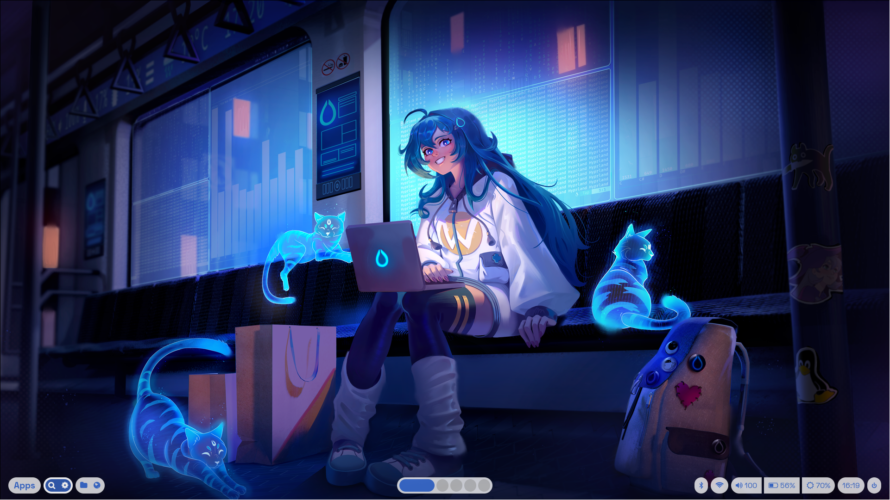
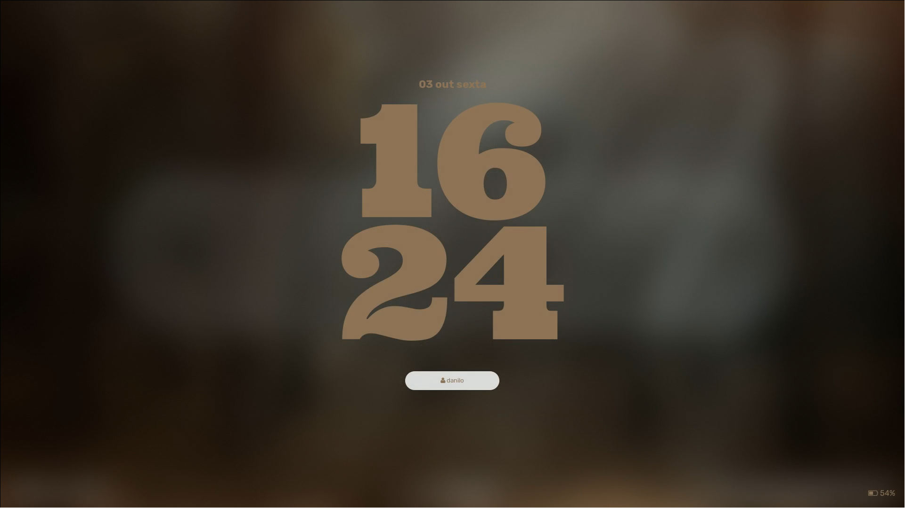
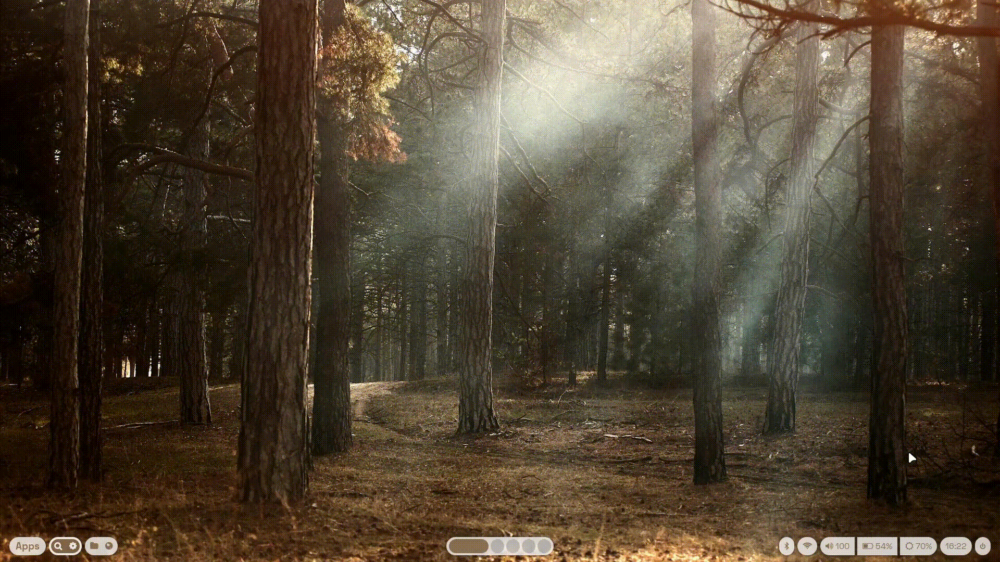
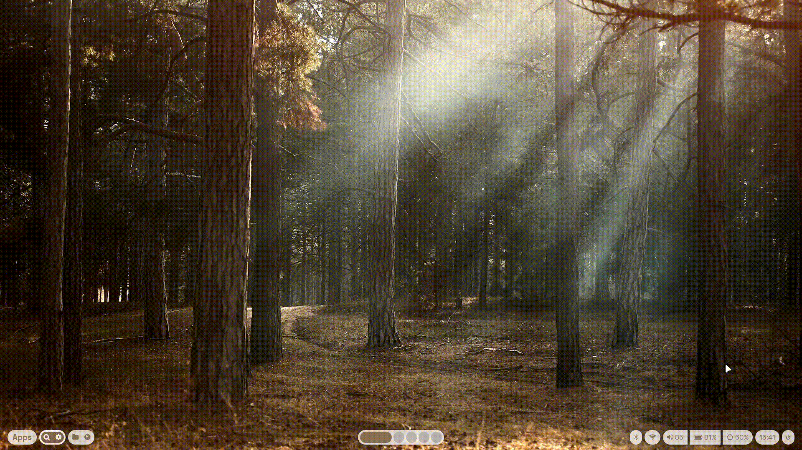

# d-Hypr (Version beta 0.1)
## About
This is my daily arch-linux setup that i use for coding, gaming and other things.
The styling was made with simplicity and minimalism in mind. To be flexible with any wallpaper the user is using

## Features (for now)
- Spotlight-like app launcher
- Elegant and flexible styling 
- Theme main color based on current wallpaper using [PyWal](https://github.com/dylanaraps/pywal)
- Widgets made using AGS:
    - App launcher
    - Brightness/volume OSD
    - Notification popup
    - ~~Wallpaper selector~~ 
### comming soon
- Global theme switcher (dark/light mode)
- SDDM display manager theme
- Theme for neovim
- More widgets:
    - Android-like dashboard
    - Bluetooth manager
    - Wifi/Network manager
    - Second app launcher that allows apps to be grouped in custom folders
    - Media player 
- Custom mouse colors
- Wallpaper randomiser

## Programs
- [Hyprland](https://hypr.land/) (**Window manager**)
- [Hyprlock](https://github.com/hyprwm/hyprlock) (**Screen lock**)
- [Waybar](https://github.com/Alexays/Waybar) (**Bar**)
- [swww](https://github.com/LGFae/swww) (**Wallpaper display**)
- [kitty](https://github.com/kovidgoyal/kitty) (**Terminal**)
- [wlogout](https://github.com/ArtsyMacaw/wlogout) (**Logout menu**)
- [sddm](https://github.com/sddm/sddm) (**Display Manager**)
- [AGS/Astal](https://github.com/aylur/astal) (**Widget framework**)
- [Dolphin](https://github.com/KDE/dolphin) (**File manager**)
- [grim](https://github.com/emersion/grim) (**Screenshot program**)
- [PyWal](https://github.com/dylanaraps/pywal) (**Pallete generator**)
- [zsh](https://github.com/zsh-users/zsh) (**Shell**)
### Not nedded
- [qimgv](https://github.com/easymodo/qimgv) (**Image viewer**)
- [yay](https://github.com/Jguer/yay) (**AUR helper**)

## Keybinds
### Hyprland
* Super = windows key
- Open terminal: Super + Q
- Open file manager: Super + E
- Open App launcher: Super + R
- Close program: Super + C
- Fullscreen: Super + Esc
- Toggle Window: Super + F
- Go to X number workspace: Super + (Workspace number key)
- Move window to X workspace: Super + Shift + (Workspace number key)
- Go to 
### Widgets
#### All
- Close widget: Esc
#### App search
- Tab: Show all

## Other stuff
- Mouse theme: Biblata-Ice
- Fonts:
    - Space-Grotesk (most of the fonts in the system)
    - Rubik
    - Ultra
- oh my zsh theme: agnoster

## Gallery
### Desktop

### Programs
#### Hyprlock

#### Wlogout

#### Widgets

