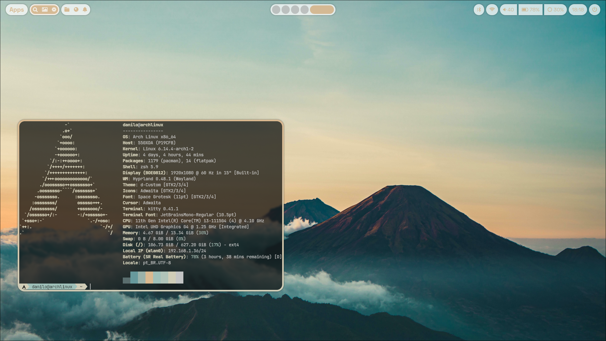

# d-Hypr (Version beta 0.1)
## About
This is my daily arch-linux setup that i use for coding, gaming and other things.
The styling was made with simplicity and minimalism in mind. To be flexible with any wallpaper the user is using 

## Features (for now)
- Spotlight-like app launcher
- Elegant and flexible styling 
- Theme main color based on current wallpaper using [PyWal]{https://github.com/dylanaraps/pywal}
- Widgets made using AGS:
    - App launcher
    - Brightness/volume OSD
    - Notification popup
    - ~~Wallpaper selector~~ 
### comming soon
- Global theme switcher (dark/light mode)
- SDDM display manager theme
- More widgets:
    - Android-like dashboard
    - Bluetooth manager
    - Wifi/Network manager
    - Second app launcher that allows apps to be grouped in custom folders
    - Media player 
- Custom theme for neovim

## Programs
- hyprland (**Window manager**)
- waybar (**Bar**)
- swww (**Wallpaper display**)
- kitty (**Terminal**)
- wlogout (**Logout menu**)
- sddm (**Display Manager**)
- AGS/Astal (**Widget framework**)
- yay (**AUR helper**)
- Dolphin (**File manager**)
- grim (**Screenshot program**)
- PyWal (**Wallpaper pallete generator**)

## credits
mouse theme: https://github.com/ful1e5/Bibata_Cursor
abstract wallpapers:
